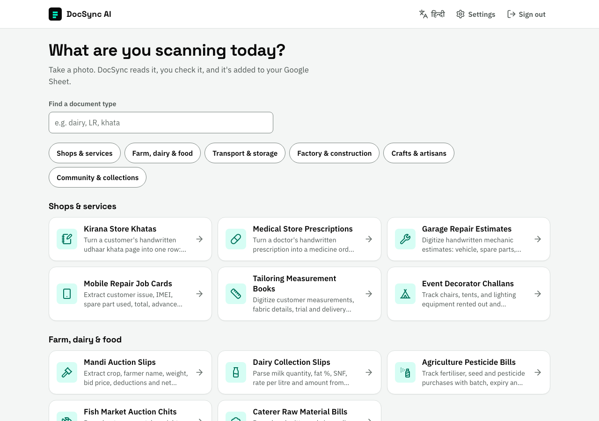
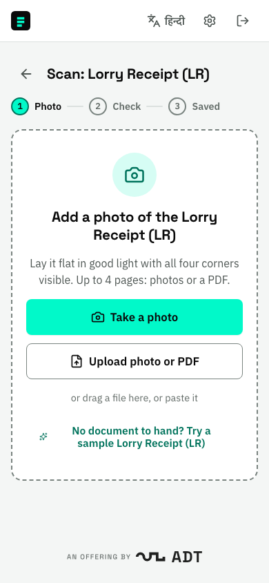

# DocSync AI

[](https://github.com/shoubhiksaha/docsync-ai/actions/workflows/production.yml)
[](https://github.com/shoubhiksaha/docsync-ai/actions/workflows/staging.yml)
[](./LICENSE)

**Photograph a paper business document and get it as a row in your Google Sheet.** DocSync AI reads
khata pages, mandi slips, lorry receipts, weight slips, muster rolls and 23 more everyday Indian
documents. You check what it read, then it saves to Google Sheets, with optional copies to Notion
and Google Drive. It works on any phone, in English and Hindi.

**Live:** [docsync.analogdigital.tech](https://docsync.analogdigital.tech) · DocSync AI is an offering by
[ADT (Analog Digital Technologies)](https://analogdigital.tech).

<p>
  
  
</p>

## Document types

| Group | Documents |
|---|---|
| Shops & services | Kirana khata · Medical prescription · Garage repair estimate · Mobile repair job card · Tailoring measurements · Event decorator challan |
| Farm, dairy & food | Mandi auction slip · Dairy collection slip · Agri input (pesticide) bill · Fish auction chit · Caterer material bill |
| Transport & storage | Fleet fuel & expenses · Lorry receipt (LR) · Courier run-sheet · Godown storage receipt |
| Factory & construction | Weighbridge slip · Material inward challan · Brick kiln token · Scrap dealer receipt · Timber measurement slip · Muster roll |
| Crafts & artisans | Handloom weaver log · Jewelry karigar job card · Handicraft piece-rate card |
| Community & collections | NGO donation receipt · Cable/WiFi receipt · Ration shop (PDS) log · Daily collection card |

Each type knows what to look for on its document and checks the result. For example: totals add
up, PAN is present on large donations, GSTIN and IMEI numbers are well-formed, and tare weight is
less than gross. Problems show up as warnings on the review screen. Aadhaar numbers are never
stored in full; only the last 4 digits are kept. Every type has a fictional sample document to try.

## How it works

1. **Pick a document type and add a photo.** Take one, upload photos or a PDF (up to 4 pages), drag
   and drop, or paste. Reading starts straight away.
2. **Check the details.** Fields that need a look are marked *Check* or *Missing*. You can:
   - edit values in place;
   - rename, remove (and restore) or add fields;
   - add a typed or voice note.
3. **Save.** The first save creates your Google Sheet, with one tab per document type. The result
   screen shows where the record went (Sheet, Notion, Drive) and lets you retry anything that failed.

**Remembered fields:** save the same fields twice and DocSync offers to remember them. Next time it
fills them in, and if everything was read clearly it saves on its own after a short countdown.

**Offline photos:** photos taken offline wait under **Recent scans** until you're back online. The
app can be installed on a phone like a native app.

**Your data:** DocSync keeps no copy of your documents. Each user's rows go only to their own
sheet. Users can bring their own AI key (Gemini, Groq, OpenAI or Anthropic), stored encrypted.

## Getting started

Requirements:
- Node.js 20 or later (CI uses 22).
- A Google OAuth client. Everyone signs in with Google.
- At least one AI provider key (Groq, OpenAI, Gemini or Anthropic). Without one, extraction returns
  each document type's sample data, which is handy for development.

```bash
cp .env.example .env.local   # fill in the values; every variable is documented there
npm install
npm run dev                  # http://localhost:3000
```

## Development

```bash
npm run lint && npm run typecheck
npm run test:coverage                # Jest unit tests
npm run build && npm run test:e2e    # Playwright: smoke, accessibility and layout on desktop and phone
npm run setup:hooks                  # pre-push guard: secret scan, no direct pushes to main/staging
```

**Modules:** the app is split into independent modules under `modules/`, each with one public
entry point: `ai`, `extraction`, `transcription`, `sheets`, `notion`, `media`, `settings`,
`profiles`, and the `sync` orchestrator. `GET /api/health` reports the state of each one.

**Fault isolation:** every call between modules has a timeout, a kill switch
(`MODULE_<NAME>=off`) and a circuit breaker, so a failure in one module never takes down the
others. If Notion is down, rows still reach Google Sheets. If transcription fails, scanning still
works.

**Adding a document type** means adding one profile file and registering it in
`modules/profiles/index.ts`. See [docs/ARCHITECTURE.md](./docs/ARCHITECTURE.md).

## Deployment

DocSync AI runs on Google Cloud Run in Mumbai, one service per environment, with the domains on
Cloudflare. Deploys run only from GitHub Actions:

1. A feature branch opens a PR into `staging`. Tests run, the deploy waits for the owner's
   approval, then contract tests run.
2. The same branch then opens a PR into `main`. The PR check confirms every commit was already
   verified on staging, tests run, the owner approves, and production deploys.

The container is defined in the [Dockerfile](./Dockerfile). See
[docs/RELEASE_FLOW.md](./docs/RELEASE_FLOW.md) for the one-time Google Cloud setup and
[docs/release_checklist.md](./docs/release_checklist.md).

## Contributing and security

See [CONTRIBUTING.md](./CONTRIBUTING.md). Please report vulnerabilities privately, as described in
[SECURITY.md](./SECURITY.md). Changes are listed in [CHANGELOG.md](./CHANGELOG.md).

## License

[MIT](./LICENSE)
