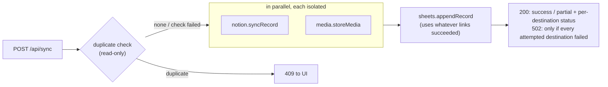

# Architecture: independent modules, contained failures

DocSync AI is one Next.js app (one Vercel project), split into modules that can each change on
their own and fail on their own. The goal is simple: **a problem in one part never takes down the
rest.** If Notion is down, rows still reach Google Sheets. If transcription breaks, scanning still
works. If a validator for one document type has a bug, the other document types are unaffected.

## Layout

```
core/                 Shared kernel. Small, stable, no feature logic. Never imports modules/ or app/.
  env.ts              Environment, version, module kill switches (MODULE_<NAME>=off)
  isolation.ts        runIsolated(): timeout + kill switch + circuit breaker, never throws
  crypto.ts           Cookie encryption (lazy key: a missing key can't crash unrelated routes)
  envelope.ts         Envelope encryption for keys stored in Firestore
  guest.ts            Signed demo sessions (Web Crypto; runs in middleware and routes)
  rate-limit.ts       Per-route-group limits + demo daily AI budget
  google-auth.ts      Google OAuth / service-account clients, Drive folder helper
  http.ts, text.ts    Request helpers, string/number helpers

modules/              Feature modules. Each has ONE public entry: modules/<name>/index.ts
  profiles/           Document "utility apps" (NGO receipts, weight slips, …) — pure data + rules
  ai/                 LLM provider chain (BYOK → Groq → OpenAI → Gemini → Anthropic)
  extraction/         Photo → fields (uses ai + profiles)
  transcription/      Voice note → text
  sheets/             Google Sheets (headers, rows, duplicates)
  notion/             Notion pages + OAuth database creation
  media/              Image/audio archive (user's Drive; demo: nothing unless opted in)
  settings/           BYOK keys + destinations (cookies, optional Firestore)
  sync/               Orchestrator: sends one document to Sheets, Notion and media

app/                  Next.js routes and UI. Routes are thin: parse → call a module → respond.
middleware.ts         Auth gate (verified session or signed guest), rate limits on every API route
```

### Rules (enforced by ESLint `no-restricted-imports`)

- Import a module only through its index: `@/modules/sheets`, never `@/modules/sheets/a1`.
  A module can rename or rewrite its internal files without touching anything else.
- `core/` never imports `modules/` or `app/`. Modules never import `app/`.
- Modules may use each other's public API (e.g. `extraction` → `ai`, `profiles`), never internals.

## How failures are contained

| Layer | Mechanism | Example |
|---|---|---|
| Deployment | Every API route is its own Vercel serverless function | A crash in `/api/transcribe` can't affect `/api/sync` |
| Import time | No module does work at import (Firestore, crypto keys and Redis are lazy) | A missing `ENCRYPTION_KEY` disables saved settings only; extraction still runs with server keys |
| Calls between modules | `runIsolated()` gives each call a timeout, kill switch and circuit breaker, and returns an outcome instead of throwing | Notion timing out after 25s is reported as `notion: failed`; the Sheets row is still written |
| Providers | The ai module tries the next provider after any error; failing server keys are paused for 60s | A retired Groq model or an exhausted OpenAI quota falls through to Gemini |
| Profiles | `deriveFields()` / `validateFields()` catch profile bugs | A broken weight-slip validator shows a warning; NGO receipts are untouched |
| UI | Route `error.tsx` boundaries + `<ModuleBoundary>` around panels | The voice-note panel crashing hides only that panel |
| Operations | `MODULE_<NAME>=off` (ai, extraction, transcription, sheets, notion, media, settings, demo) | During a Notion incident, set `MODULE_NOTION=off` in Vercel and redeploy the same build — no code change |
| Visibility | `GET /api/health` reports each module's enabled/configured/circuit state | Post-deploy contract tests and uptime checks read it |

### The sync flow



The duplicate check runs before anything is written, so a duplicate never leaves a Notion page
behind without its Sheets row.

## Changing things independently

- **Add or change a document type:** edit or add one file in `modules/profiles/` and list it in
  `modules/profiles/index.ts`. Extraction prompts, Sheets tab, Notion properties, mock data and
  business-rule warnings all come from the profile. Nothing else changes.
- **Swap a provider or model:** `modules/ai/providers.ts`, or set `OPENAI_VISION_MODEL`,
  `GEMINI_VISION_MODEL`, `GROQ_VISION_MODEL`, `ANTHROPIC_VISION_MODEL` per environment.
- **Change how Sheets lays out rows:** `modules/sheets/a1.ts` (pure functions, fully unit-tested).
- **Add a destination:** create `modules/<name>/` with an `index.ts` and a `<name>Health()`, add it
  to the orchestrator in `modules/sync` behind `runIsolated()`, and to `/api/health`.

## Tests

`__tests__/modules/sync.test.ts` is the contract for isolation: each destination failing, hanging
or being switched off while the others still complete. `__tests__/core/isolation.test.ts` covers
timeouts and circuit breakers. Coverage thresholds apply to `core/`, `modules/` and `middleware.ts`.
