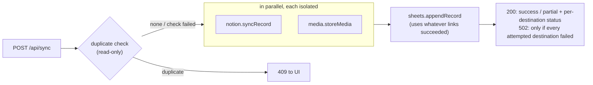

# Architecture: independent modules, contained failures

DocSync AI is one Next.js app (one Cloud Run service per environment), split into modules that can each change on
their own and fail on their own. The goal is simple: **a problem in one part never takes down the
rest.** If Notion is down, rows still reach Google Sheets. If transcription breaks, scanning still
works. If a validator for one document type has a bug, the other document types are unaffected.

## Layout

```
core/                 Shared kernel. Small, stable, no feature logic. Never imports modules/ or app/.
  env.ts              Environment, version, module kill switches (MODULE_<NAME>=off)
  isolation.ts        runIsolated(): timeout + kill switch + circuit breaker, never throws
  crypto.ts           Cookie encryption (lazy key: a missing key can't crash unrelated routes)
  envelope.ts         Envelope encryption for keys stored in Firestore
  rate-limit.ts       Per-route-group limits for signed-in clients
  telemetry.ts        Allow-listed, scrubbed product events → one JSON log line each
  google-auth.ts      Google OAuth client for the signed-in user, Drive folder helper
  http.ts, text.ts    Request helpers, string/number helpers

modules/              Feature modules. Each has ONE public entry: modules/<name>/index.ts
  profiles/           Document "utility apps" (NGO receipts, weight slips, …) — pure data + rules,
                      default duplicate-check field, Hindi copy
  ai/                 LLM provider chain (BYOK → Groq → OpenAI → Gemini → Anthropic)
  extraction/         Photo → fields (uses ai + profiles)
  transcription/      Voice note → text
  sheets/             Google Sheets (headers, rows, duplicates)
  notion/             Notion pages + OAuth database creation
  media/              Image/audio archive in the user's own Drive
  settings/           BYOK keys + destinations + per-profile prefs (cookies, optional Firestore)
  sync/               Orchestrator: sends one document to Sheets, Notion and media

client/               Browser logic shared by the UI. No React components; talks to the server only
  scan-flow.ts        through API routes. The scan flow as a pure state machine (unit-tested)
  api.ts              Typed calls to the API routes; every failure becomes an ErrorCode
  images.ts           Photos/PDFs → JPEG pages (pdf.js loads only when a PDF is added), page stitching
  scan-store.ts       IndexedDB: offline captures and saves with a destination to retry
  telemetry.ts        Batched usage events + client error reports → /api/telemetry
  i18n/               English + Hindi copy (typed keys), provider, server helper

app/                  Next.js routes and UI. Routes are thin: parse → call a module → respond.
  components/ui/      Design-system kit: Button, Dialog (native <dialog>), Badge, Notice, Card,
                      Stepper, fields. Colours/spacing only from tokens in app/globals.css
  scan/[profile]/     ScanClient (orchestrator) + one component per step
middleware.ts         Auth gate (Google session required), rate limits on every API route
```

### Rules (enforced by ESLint `no-restricted-imports`)

- Import a module only through its index: `@/modules/sheets`, never `@/modules/sheets/a1`.
  A module can rename or rewrite its internal files without touching anything else.
- `core/` never imports `modules/` or `app/`. Modules never import `app/`.
- Modules may use each other's public API (e.g. `extraction` → `ai`, `profiles`), never internals.
- `client/` never imports `core/`, `modules/` or `app/` (it is bundled into the browser).

## How failures are contained

| Layer | Mechanism | Example |
|---|---|---|
| Deployment | Stateless Cloud Run instances: an error in a route fails only that request, and an instance that dies is replaced while others keep serving | An exception in `/api/transcribe` returns an error for that call; `/api/sync` keeps working |
| Import time | No module does work at import (Firestore, crypto keys and Redis are lazy) | A missing `ENCRYPTION_KEY` disables saved settings only; extraction still runs with server keys |
| Calls between modules | `runIsolated()` gives each call a timeout, kill switch and circuit breaker, and returns an outcome instead of throwing | Notion timing out after 25s is reported as `notion: failed`; the Sheets row is still written |
| Providers | The ai module tries the next provider after any error; failing server keys are paused for 60s | A retired Groq model or an exhausted OpenAI quota falls through to Gemini |
| Profiles | `deriveFields()` / `validateFields()` catch profile bugs | A broken weight-slip validator shows a warning; NGO receipts are untouched |
| UI | Route `error.tsx` boundaries + `<ModuleBoundary>` around panels | The voice-note panel crashing hides only that panel |
| Operations | `MODULE_<NAME>=off` (ai, extraction, transcription, sheets, notion, media, settings) | During a Notion incident, upload `MODULE_NOTION=off` with `scripts/gcp/push-env.sh` and re-run the deploy — no code change |
| Visibility | `GET /api/health` reports each module's enabled/configured/circuit state; `settings.persistence` is `ok`, `unreachable` (credentials set but Firestore doesn't answer, e.g. API disabled or database missing; reported as `degraded`) or `not_configured`. Firestore is probed with one small read at most once a minute, and a failing Firestore is skipped and logged once a minute, not on every request. No internal error text is ever in the response | Post-deploy contract tests and uptime checks read it |

### The sync flow



The duplicate check runs before anything is written, so a duplicate never leaves a Notion page
behind without its Sheets row.

Every destination in the response carries a machine-readable `code` so the UI can explain it
without parsing text: `saved`, `failed`, or for a skip `not_connected`, `not_selected`,
`nothing_to_store`, `not_stored` (Google session expired, so the photo wasn't kept), `not_retried`,
`disabled` (kill switch), `paused` (circuit breaker open), `duplicate`, or `skipped`. The response
also returns `spreadsheetId` and `spreadsheetUrl`.

**Retrying one destination.** `only=notion,media` (form field) runs just those destinations; the
rest are skipped as `not_retried`, and the duplicate check runs only when `sheets` is included. A
failed Notion page can therefore be retried without adding a second Sheets row.

**Which sheet and which duplicate field.** Signed-in users' spreadsheet ID comes from the form,
else the `docsync_sheet_<profile>` cookie, else the sheets module finds or creates "DocSync AI
Data"; a successful sync stores the ID in that cookie. The duplicate-check field is the user's
saved preference, else the profile's `duplicateKey` (`''` saved by the user turns checks off).

## Other API contracts

| Route | Contract |
|---|---|
| `POST /api/extract-freeform` | 1–4 `document` entries = pages of one document (images; the client renders PDFs). All pages go to the model in one request. Errors return `{ error, code }` with `code` ∈ `bad_input`, `too_large`, `quota`, `unavailable`, `internal`; messages are plain language, provider details stay in server logs. |
| `GET /api/settings` | `hasOpenAiKey`, `hasNotionKey`, `hasNotionDbId`, `uploadDest`, `isPersistent` (chosen *and* Firestore is answering), `syncAvailable` (Firestore is answering; the Settings page disables the choice otherwise), `aiKeyHint` (masked, e.g. `gsk_…a1b2`), `aiProvider`. Saved keys never leave the server. |
| `POST /api/settings` | Partial update: only fields present change; `''` removes a value. Persistent mode changes only when `persistent` is sent. |
| `GET/POST /api/profile-prefs` | Per-profile `fields` (remembered field list, `null` = review every scan) and `primaryKey` (`null` = profile default, `''` = no duplicate check), plus `defaultPrimaryKey`. Stored in the encrypted `docsync_prefs` cookie and, in persistent mode, in Firestore `users/{email}.profilePrefs`. |
| `POST /api/telemetry` | `{ event, props }` or `{ events: [...] }` (≤ 20). Unknown events/props are dropped, strings capped, emails and 6+ digit runs scrubbed; each event becomes one `{"type":"telemetry",…}` log line with the caller kind only. Own rate-limit group. Returns 204. |

## UI

The UI follows the same idea: small parts with clear contracts.

- **Home page** (`app/components/AppPicker.tsx`): the apps grouped by `profile.group`, with jump
  links per group and a search that matches every typed word against the English and Hindi title,
  document name and description (case, accents and the Hindi nukta are ignored).
- **Scan flow** (`client/scan-flow.ts`): `capture → extracting → review → saving → done` as a pure
  reducer. Components render a step and dispatch actions; the transitions (templates, auto-save,
  retries, "nothing saved → stay on review") are unit-tested without a browser.
- **First scan, few decisions:** extraction starts as soon as a photo is added; the sheet is
  created by the server on first save; the duplicate-check field defaults to the profile's
  `duplicateKey`; "Remember these fields?" is offered only after the same fields were saved twice.
  Remembered fields that all come back ≥95% confident save themselves after a 5-second, cancellable
  countdown.
- **Dialogs** use the native `<dialog>` element (top layer, focus trap, Esc). Nothing uses a CSS
  transform on a page wrapper, because that traps `position: fixed` children.
- **Honest results:** the done screen shows each destination's `code` from `/api/sync` (saved,
  not connected, not stored, paused, failed + retry).
- **Offline:** photos added offline are kept in IndexedDB and listed under Recent scans on the home
  page, ready to process once back online. `public/sw.js` serves cached pages when offline
  (network-first; content-hashed assets cache-first). Sign-out clears caches, IndexedDB and
  `docsync_*` localStorage.
- **Accessibility:** WCAG 2.2 AA colour tokens (light and dark), visible focus ring, 44px targets,
  labelled fields, pinch-zoom allowed, no orientation lock. `e2e/tests/ux.spec.ts` runs axe and
  layout checks on desktop and phone viewports in CI.
- **Language:** English and Hindi (`docsync_lang` cookie, toggle in the navbar). `hi.ts` is typed
  against `en.ts`, and a unit test checks every placeholder matches.
- **Brand:** DocSync AI is an offering by ADT (Analog Digital Technologies). The tokens use ADT's
  palette (Signal Aqua `#01F9C9`, Deep Black `#0A0A0A`) and type (Space Grotesk headings, IBM Plex
  Sans text). On light surfaces aqua is only a fill under black text; aqua text, thin borders and
  focus rings use `--accent-text` (`#00735C`). "An offering by ADT" (`app/components/AdtEndorsement.tsx`)
  is stacked under the sign-in card and one line at the bottom of every other page and
  `offline.html`, and links to analogdigital.tech. The SVGs in `public/brand/` come unchanged from
  ADT's brand kit (`ADT Papers/brand/logo/final/endorsement`); replace them from there, never edit them.

## Changing things independently

- **Add or change a document type:** edit or add one file in `modules/profiles/` and list it in
  `modules/profiles/index.ts`. Extraction prompts, Sheets tab, Notion properties, mock data,
  home-page group and business-rule warnings all come from the profile. Nothing else changes.
  - Each profile has a contract test (`__tests__/helpers/profile-contract.ts`): Hindi copy, a mock
    that passes its own checks, Notion properties that match its fields, a sample document.
  - Draw its fictional sample as `scripts/samples/<id>.html` and run
    `node scripts/samples/render.mjs <id>` to write `public/samples/<id>.jpg`.
  - Shared checks (vehicle numbers, GSTIN, mobile numbers, money tolerance, Aadhaar masking) live
    in `modules/profiles/checks.ts`.
  - All apps share one Notion database, so a property name means the same type everywhere and a
    profile writes at most 3 properties; the registry test enforces both.
  - A page with many entries (a khata page, a muster roll) is one row: totals as fields plus one
    compact "Items"/"Entries" text field. Profiles never store a full Aadhaar number.
- **Swap a provider or model:** `modules/ai/providers.ts`, or set `OPENAI_VISION_MODEL`,
  `GEMINI_VISION_MODEL`, `GROQ_VISION_MODEL`, `ANTHROPIC_VISION_MODEL` per environment.
- **Change how Sheets lays out rows:** `modules/sheets/a1.ts` (pure functions, fully unit-tested).
- **Change copy or add a language:** `client/i18n/` (add a dictionary typed `Record<MessageKey, string>`).
- **Change the look:** tokens in `app/globals.css` (ADT's palette; see Brand above), components in
  `app/components/ui/`.
- **Add a destination:** create `modules/<name>/` with an `index.ts` and a `<name>Health()`, add it
  to the orchestrator in `modules/sync` behind `runIsolated()`, and to `/api/health`.

## Tests

`__tests__/modules/sync.test.ts` is the contract for isolation: each destination failing, hanging
or being switched off while the others still complete. `__tests__/core/isolation.test.ts` covers
timeouts and circuit breakers. `__tests__/client/` covers the scan state machine, the API client and
the translations. Coverage thresholds apply to `core/`, `modules/`, `middleware.ts` and the pure
`client/` files. Playwright: `smoke.spec.ts` (API + sign-in gate) and `ux.spec.ts` (accessibility and
layout on desktop + phone) run in CI against the production build in mock mode. They sign in with a
session cookie signed by the test server's own `NEXTAUTH_SECRET` (`e2e/support/session.ts`), so
no login route exists only for tests.
