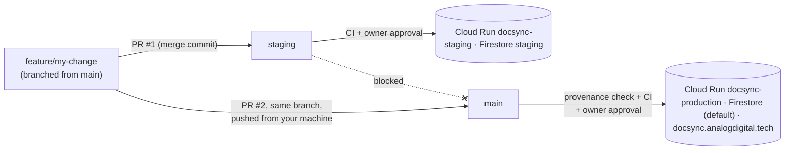

# Release flow: staging first, then main, never staging → main

DocSync AI has two environments, each its own Cloud Run service in Mumbai (`asia-south1`,
Google Cloud project `docsyncai1`). Each has its own settings in Secret Manager and its own
Firestore database. Rows always go to each signed-in user's own Google Sheet, so there is no
shared sheet to keep apart.

| Environment | Git branch | Cloud Run service | Firestore database | URL |
|---|---|---|---|---|
| Staging | `staging` | `docsync-staging` | `staging` | `STAGING_DOMAIN` (https://docsync-staging.analogdigital.tech), or the run.app URL printed by the deploy job |
| Production | `main` | `docsync-production` | `(default)` | https://docsync.analogdigital.tech |

Shared by both: the Google OAuth client, the Firebase project, the AI provider accounts and
billing. A user who signs in on staging also exists in production, but their saved settings in
staging live only in the `staging` Firestore database.

How the split is wired:
- GitHub Actions is the only deploy path. `scripts/ci/deploy.sh <environment>` builds the
  `Dockerfile`, pushes the image to Artifact Registry (`asia-south1-docker.pkg.dev/docsyncai1/docsync`)
  and deploys it to that environment's service. It signs in to Google with Workload Identity
  Federation, so no Google key is stored in GitHub, and only this repository's `staging` and
  `production` environments can use it.
- Each environment's settings are one Secret Manager secret, `<environment>-env` (a whole
  `.env` file), uploaded with `scripts/gcp/push-env.sh`. Cloud Run mounts it at
  `/secrets/app.env` and Node loads it at start. The deploy sets `APP_ENV`, `NEXTAUTH_URL` and
  `FIRESTORE_DATABASE_ID` itself, and those take precedence.
- The public domains reach Cloud Run through a Cloudflare Worker on ADT's Cloudflare account
  ([deploy/cloudflare-proxy](../deploy/cloudflare-proxy/README.md)), because Cloud Run can't map
  custom domains in Mumbai.
- `GET /api/health` reports the environment (`APP_ENV`) and the git SHA it was built from. The
  post-deploy contract tests check both, so a production deploy carrying staging settings or a
  stale build fails verification.



## The rules

1. **Every change starts as a feature branch cut from `main`.** Never branch from `staging`:
   staging contains other unreleased work.
2. **First stop is staging.** Open a PR from the feature branch into `staging` and merge it with a
   **merge commit** (squash and rebase are turned off for the repo). The `Staging Deploy`
   workflow re-runs the quality gate and then waits for the owner to approve the deploy in the
   `staging` environment. After the deploy, "Post-Deploy Verification (Staging)" runs the
   contract tests against the staging URL.
3. **Verify on staging.** Use the staging URL in a private window and sign in with a Google test
   account. Staging stores settings in the `staging` database only.
4. **Then promote the same feature branch to main from your machine:**
   ```bash
   git checkout feature/my-change
   npm run promote            # = scripts/promote-to-main.sh
   ```
   This runs the branch-policy check locally, pushes the branch, and opens PR #2 into `main`.
   Merge it with a merge commit. The `Production Deploy` workflow re-checks provenance, runs the
   quality gate, and waits for the owner to approve the deploy in the `production` environment.
5. **`staging` never merges into `main`.** CI rejects:
   - a PR whose head branch is `staging`;
   - any branch that contains a staging merge commit (for example after `git merge staging`);
   - any commit that hasn't already been merged into staging.

   The same check runs again after every push to `main`, and production deploys are blocked if
   it fails.

## What enforces it

| Layer | File | What it does |
|---|---|---|
| PR check | `.github/workflows/pr-check.yml` → `scripts/ci/branch-policy.sh` | The "Branch Policy" required check on PRs into `main`/`staging` |
| Push check | `.github/workflows/production.yml` (job "Staging Provenance") | Re-runs the policy on what actually landed on `main` before any deploy |
| Tests | `.github/workflows/quality.yml` | Conflict markers, secret scan, lint + types, dependency audit, unit tests with coverage, production build and an E2E smoke run — the same suite on PRs, staging pushes and main pushes |
| Approval | GitHub environments `staging` and `production` | The deploy job waits for the owner's approval; each environment only accepts its own branch |
| Verification | `e2e/tests/contract.spec.ts` | After each deploy: health reports the right environment and commit, the auth gate holds, login renders cleanly |
| Branch protection | `scripts/setup-repo-governance.sh` | PRs + required checks on `main` and `staging` (no approving review; the environment approval gates deploys); no force-push or delete |
| Local guard | `scripts/git-hooks/pre-push` (`npm run setup:hooks`) | Stops `git push origin main`/`staging` from your laptop and blocks pushes that contain secrets |
| Deploy path | `scripts/ci/deploy.sh` + Workload Identity Federation | Only the approved deploy jobs can sign in to Google Cloud; `deploy.sh` refuses to run outside GitHub Actions |
| Ownership | `.github/CODEOWNERS` | Every change is owned by @shoubhiksaha |

## One-time setup (owner)

```bash
gh auth status                              # must be a repo admin
scripts/setup-repo-governance.sh --dry-run  # review what will change
scripts/setup-repo-governance.sh            # staging branch, environments, protection, merge settings
npm run setup:hooks                         # local pre-push guard (each clone)
```

Google Cloud (once, signed in with `gcloud` as a project owner):

```bash
bash scripts/gcp/setup.sh
```

It turns on Cloud Run, Artifact Registry, Secret Manager and the three IAM APIs that keyless
sign-in needs; creates the image repository (keeps the 4 newest images), a runtime service
account per environment and the deployer account; and sets the GitHub repository variables
`GCP_WORKLOAD_IDENTITY_PROVIDER` and `GCP_SERVICE_ACCOUNT`. It is safe to re-run.

Settings for each environment: write them to a local, git-ignored file in the `.env.example`
format, then upload:

```bash
bash scripts/gcp/push-env.sh staging    .env.staging.local
bash scripts/gcp/push-env.sh production .env.production.local
```

Include `NEXTAUTH_SECRET`, `ENCRYPTION_KEY`, the Google OAuth client, the service account, the AI
keys and `PROXY_SECRET` (a different value per environment; with it set, the app refuses requests
that don't come through the Cloudflare Worker); leave out `APP_ENV`, `NEXTAUTH_URL` and `FIRESTORE_DATABASE_ID` (the
deploy sets those). New values apply on the next deploy. Only that environment's runtime service
account can read its secret.

**Running cost** at DocSync's current traffic is a few rupees a month at most. Google Cloud's free
allowances are per billing account, so they're shared with any other project billed to it.
- **Cloud Run:** Mumbai is a Tier 1 region. 2 million requests, 180,000 vCPU-seconds and 360,000
  GiB-seconds a month are free.
- **Secret Manager:** 2 secrets with one version each. 6 active versions a month are free.
- **Artifact Registry:** the 4 newest images. Each is about 108 MB compressed, and they share
  layers. 0.5 GB is free, then $0.10 per GB a month.
- **Data sent to users:** billed from Mumbai at Google's internet rates. Cloudflare caches
  `/_next/static` files, which are most of the bytes.
- **Firestore:** only the `(default)` database gets the free quota. The `staging` database is
  billed for every read and write, which is a few paise at staging's volume.

Don't add a secret per setting, raise the image count, or set minimum instances above 0
without checking the bill.

Staging domain: `gh variable set STAGING_DOMAIN --env staging --body docsync-staging.analogdigital.tech`,
then publish the staging Worker ([deploy/cloudflare-proxy](../deploy/cloudflare-proxy/README.md)).
Publish the production Worker only after the first production deploy, because it takes over the
domain from Vercel at that moment.

Create the `staging` Firestore database once in the Firebase console (Firestore → Create
database → ID `staging`). Add each domain to the Google OAuth client's authorized origins and
redirect URIs (`<url>/api/auth/callback/google`).

**Solo owner:** GitHub never lets you approve your own pull request, so PRs need no approving
review. Every PR must still pass the required checks, and every deploy waits for your approval
on its environment.

## Hotfixes and rollbacks

There is no shortcut around staging. For an urgent fix: branch from `main`, PR into `staging`,
approve the staging deploy, smoke-test, then `npm run promote` and approve production. That is
four clicks plus CI time.

To roll back: in Cloud Run → `docsync-production` → Revisions, send 100% of traffic to the
previous revision (or `gcloud run services update-traffic docsync-production --region asia-south1
--to-revisions <previous>=100`). Then `git revert -m 1
<merge-sha>` on a new branch and ship the revert through the same flow.

## Keeping staging close to main

After a production release, staging can lag behind main's merge commits. Bring it up to date
with a PR from `main` into `staging` (main → staging is allowed; the reverse is not).
