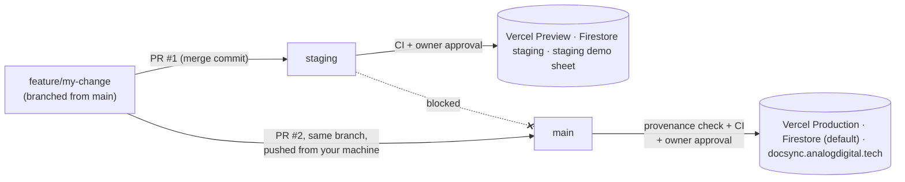

# Release flow: staging first, then main, never staging → main

DocSync AI has two environments inside one Vercel project. Each environment has its own Vercel
environment variables, its own Firestore database and its own demo Google Sheet.

| Environment | Git branch | Vercel environment | Firestore database | Demo sheet | URL |
|---|---|---|---|---|---|
| Staging | `staging` | Preview (aliased to `STAGING_DOMAIN` when set) | `staging` (`FIRESTORE_DATABASE_ID=staging`) | staging `GOOGLE_SHEET_ID` | `STAGING_DOMAIN`, or the preview URL printed by the deploy job |
| Production | `main` | Production | `(default)` | production `GOOGLE_SHEET_ID` | https://docsync.analogdigital.tech |

Shared by both: the Google OAuth client, the Firebase project, the AI provider accounts and
billing. A user who signs in on staging also exists in production, but their saved settings in
staging live only in the `staging` Firestore database.

How the split is wired:
- Vercel's own git integration is turned off (`vercel.json` → `git.deploymentEnabled: false`).
  GitHub Actions is the only deploy path.
- `scripts/ci/deploy.sh staging` runs `vercel pull --environment=preview`, builds and deploys a
  preview deployment, then aliases it to `STAGING_DOMAIN`. `deploy.sh production` pulls the
  production variables and deploys with `--prod`.
- Each environment's runtime settings are Vercel environment variables: set them under
  Vercel → Project → Settings → Environment Variables, separately for **Preview** and **Production**.
- `GET /api/health` reports the environment (`APP_ENV`, else derived from `VERCEL_ENV`) and the
  git SHA it was built from. The post-deploy contract tests check both, so a production deploy
  carrying preview settings or a stale build fails verification.



## The rules

1. **Every change starts as a feature branch cut from `main`.** Never branch from `staging`:
   staging contains other unreleased work.
2. **First stop is staging.** Open a PR from the feature branch into `staging` and merge it with a
   **merge commit** (squash and rebase are turned off for the repo). The `Staging Deploy`
   workflow re-runs the quality gate and then waits for the owner to approve the deploy in the
   `staging` environment. After the deploy, "Post-Deploy Verification (Staging)" runs the
   contract tests against the staging URL.
3. **Verify on staging.** Use the staging URL in a private window: demo mode and a Google login
   with a test account. Staging writes to its own demo sheet and the `staging` database only.
4. **Then promote the same feature branch to main from your machine:**
   ```bash
   git checkout feature/my-change
   npm run promote            # = scripts/promote-to-main.sh
   ```
   This runs the branch-policy check locally, pushes the branch, and opens PR #2 into `main`.
   Merge it with a merge commit. The `Production Deploy` workflow re-checks provenance, runs the
   quality gate, and waits for the owner to approve the deploy in the `production` environment.
5. **`staging` never merges into `main`.** CI rejects:
   - a PR whose head branch is `staging`;
   - any branch that contains a staging merge commit (for example after `git merge staging`);
   - any commit that hasn't already been merged into staging.

   The same check runs again after every push to `main`, and production deploys are blocked if
   it fails.

## What enforces it

| Layer | File | What it does |
|---|---|---|
| PR check | `.github/workflows/pr-check.yml` → `scripts/ci/branch-policy.sh` | The "Branch Policy" required check on PRs into `main`/`staging` |
| Push check | `.github/workflows/production.yml` (job "Staging Provenance") | Re-runs the policy on what actually landed on `main` before any deploy |
| Tests | `.github/workflows/quality.yml` | Conflict markers, secret scan, lint + types, dependency audit, unit tests with coverage, production build and an E2E smoke run — the same suite on PRs, staging pushes and main pushes |
| Approval | GitHub environments `staging` and `production` | The deploy job waits for the owner's approval; each environment only accepts its own branch |
| Verification | `e2e/tests/contract.spec.ts` | After each deploy: health reports the right environment and commit, the auth gate holds, login renders cleanly |
| Branch protection | `scripts/setup-repo-governance.sh` | PRs + required checks on `main` and `staging` (no approving review; the environment approval gates deploys); no force-push or delete |
| Local guard | `scripts/git-hooks/pre-push` (`npm run setup:hooks`) | Stops `git push origin main`/`staging` from your laptop and blocks pushes that contain secrets |
| Deploy path | `vercel.json` + `scripts/ci/deploy.sh` | Vercel no longer deploys on git push; `deploy.sh` refuses to run outside GitHub Actions |
| Ownership | `.github/CODEOWNERS` | Every change is owned by @shoubhiksaha |

## One-time setup (owner)

```bash
gh auth status                              # must be a repo admin
scripts/setup-repo-governance.sh --dry-run  # review what will change
scripts/setup-repo-governance.sh            # staging branch, environments, protection, merge settings
npm run setup:hooks                         # local pre-push guard (each clone)
```

Vercel credentials for GitHub Actions:

1. Create a token at vercel.com/account/tokens (scope: the team or account that owns the project).
2. Store it on both GitHub environments:
   ```bash
   gh secret set VERCEL_TOKEN --env staging
   gh secret set VERCEL_TOKEN --env production
   ```
3. Set the project ids as variables on both environments. The values are in
   `.vercel/project.json` after `vercel link` (`orgId`, `projectId`):
   ```bash
   gh variable set VERCEL_ORG_ID     --env staging    --body <orgId>
   gh variable set VERCEL_PROJECT_ID --env staging    --body <projectId>
   gh variable set VERCEL_ORG_ID     --env production --body <orgId>
   gh variable set VERCEL_PROJECT_ID --env production --body <projectId>
   ```
4. Optional: `gh variable set STAGING_DOMAIN --env staging --body staging.docsync.analogdigital.tech`
   after adding that domain to the Vercel project. Without it, staging uses the preview URL that
   the deploy job prints.
5. Optional: if Vercel Deployment Protection is on for previews, create a "Protection Bypass for
   Automation" secret in Vercel and store it as a **repository** secret (the verification job has
   no environment, so it can't read environment secrets):
   `gh secret set VERCEL_AUTOMATION_BYPASS_SECRET`.

Vercel environment variables (Project → Settings → Environment Variables):

| Variable | Preview (staging) | Production |
|---|---|---|
| `FIRESTORE_DATABASE_ID` | `staging` | unset or `(default)` |
| `GOOGLE_SHEET_ID` | the staging demo sheet | the production demo sheet |
| `NEXTAUTH_URL` | the staging URL | `https://docsync.analogdigital.tech` |
| `APP_ENV` | optional, `staging` | optional, `production` |
| `NEXTAUTH_SECRET`, `ENCRYPTION_KEY`, Google OAuth, service account, AI keys | set for each environment | set for each environment |

Create the `staging` Firestore database once in the Firebase console (Firestore → Create
database → ID `staging`). Add the staging URL to the Google OAuth client's authorized origins and
redirect URIs (`<staging-url>/api/auth/callback/google`).

**Solo owner:** GitHub never lets you approve your own pull request, so PRs need no approving
review. Every PR must still pass the required checks, and every deploy waits for your approval
on its environment.

## Hotfixes and rollbacks

There is no shortcut around staging. For an urgent fix: branch from `main`, PR into `staging`,
approve the staging deploy, smoke-test, then `npm run promote` and approve production. That is
four clicks plus CI time.

To roll back: in Vercel → Project → Deployments, open the previous production deployment and
choose **Instant Rollback** (or run `vercel rollback` with a token). Then `git revert -m 1
<merge-sha>` on a new branch and ship the revert through the same flow.

## Keeping staging close to main

After a production release, staging can lag behind main's merge commits. Bring it up to date
with a PR from `main` into `staging` (main → staging is allowed; the reverse is not).
